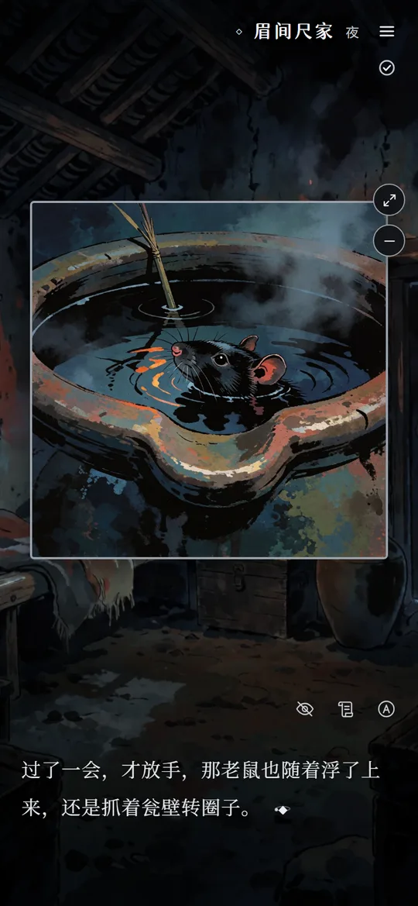
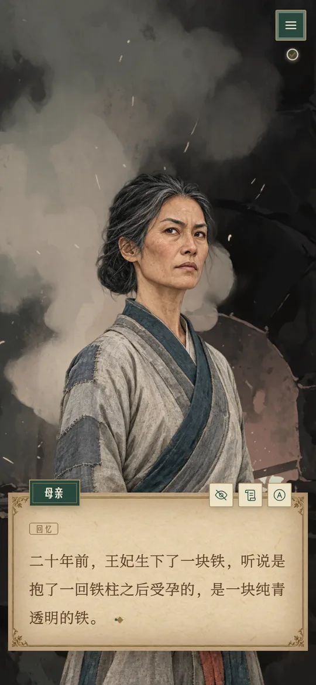
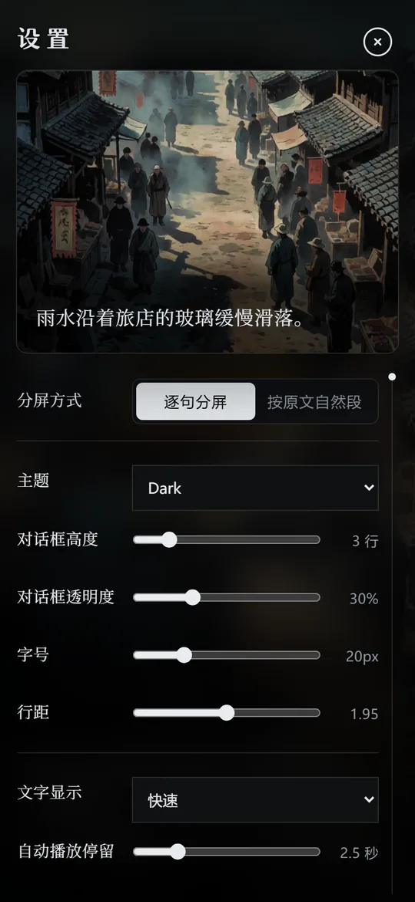
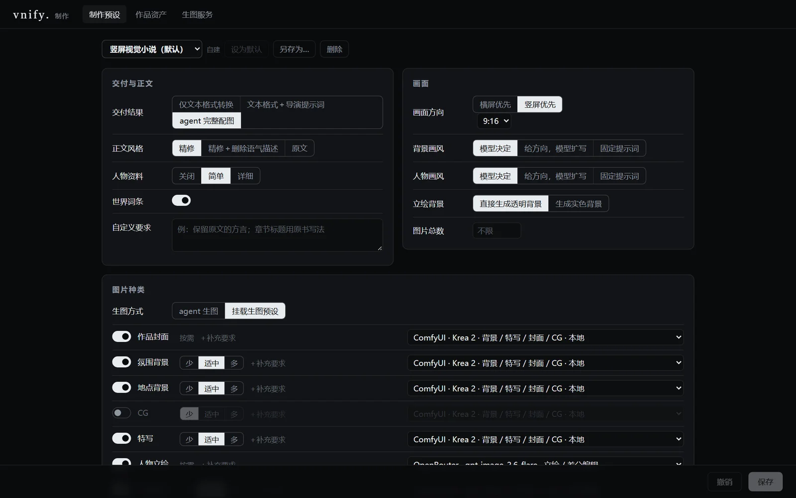

<h1 align="center">vnify.</h1>

<p align="center">把文本改编成带背景、立绘与演出的视觉小说，在本地或个人云端书架阅读。</p>

<p align="center">
  
  
  
  
</p>
<p align="center"><sub>示例：鲁迅《铸剑》，由 Agent 转换并完整配图，手机竖屏阅读。左起：场景旁白、特写插图、回忆、人物对白。</sub></p>

---

**vnify.** 将文本（TXT、EPUB）转化为带演出效果的线性视觉小说脚本（`.vn.txt`），结合背景、人物立绘、CG 与特写插图，生成可独立分享的作品包（`.vn.zip`），并在本地或个人云端书架中提供沉浸式阅读体验。

小说拥有绵密的叙述与心理描写，而视觉小说擅长用画面、立绘调度与分屏节奏营造临场感。vnify. 连接这两种媒介：在完整保留原著文脉与信息揭示顺序的前提下，通过 AI Agent 辅助完成剧本改编、人物档案整理与分镜导演，配合本地资产管理器完成配图与打包。

---

## 核心功能

### 舞台化阅读体验
- **忠实原著的改编幅度**：保留原书的事件因果、修辞与叙述视角。提供三种改编风格——默认“精修”在利用人物标签明确对白归属的同时，将冗余的“某某说道”精简或转化为伴随动作与神态描写；“精修＋删除语气描述”进一步完全隐去说话方式相关的修饰语，仅保留动作与情节陈述；“原文”逐句照录原文、不改写对白的呈现形式，适合对话很少的作品与非小说文本，人物、词条与配图可按需制作。
- **对白、心声与人物提及**：独立呈现人物对白与内心独白；第一人称叙述者的心理活动通常自然融入旁白，第三人称明确的心理语言可转为心声。正文中人物称呼染色，悬停显示无剧透简单信息卡片，帮助读者记忆。
- **三种正文承载形式**：将小说组织为具体场景（`scene`）、跨时空叙述（`narration`）与独立文档（`document`）。场景与叙述采用底幕逐句或按自然段推进；信件、公文、报刊以独立纸面排版呈现，题记与诗歌居中渐显。
- **立绘调度与演出**：支持多人同屏立绘、说话人高亮与自动上下场排布，支持人物与地点的状态差分（衣着、年龄、昼夜、天气等）、全屏事件 CG、行间特写插图，以及回忆、梦境等视觉氛围切换。
- **多语言支持**：目前支持简体中文、繁体中文、英文与日文作品（日文不显示振假名）。制作工具按作品语言分句与识别对白，播放器随作品语言切换界面文字与字体，书架界面可选语言。
- **原书内容保留**：自动提取并保留 EPUB 原书插图、封面及序言、后记、人物表等附录文本，原书插图可在对应正文段落随行展示。

### 随进度解锁的资料与词条
- **防剧透人物档案**：人物姓名、简介、关系与详情条目随阅读位置逐步解锁，向前回退进度时自动还原至当时的认知状态。
- **行内注解与世界词条**：支持原书注释与作品专属名词释义的悬停查看，阅读菜单内提供已解锁词条的检索面板与防剧透雾化图集。

<p align="center">
  
  
  
  
</p>
<p align="center"><sub>演员表、世界词条、阅读设置与书架。</sub></p>

### AI 辅助改编与导演规划
- **确定性工具与 Agent 协同**：命令行工具负责原文行号映射、EPUB 解析、分批组装与严格语法校验；Agent 负责文本分镜改写、人物与词条提炼、全书美术风格设计及各章配图规划。
- **逐句来源可追溯**：每个文本单元均绑定原书段落编号，校验工具自动核对编号覆盖范围与引用完整性。

### 本地资产管理器
- **可视化资产与提示词管理**：在浏览器中按分类浏览全书封面、氛围图、地点背景、人物立绘、CG、特写与差分，调整立绘头像裁切框与镜像朝向，直接修改导演画面描述或生图提示词，重新生成或上传图片。
- **接入生图工作流**：支持连接 NovelAI、本地或云端 ComfyUI（自动识别 API 工作流节点）与 OpenAI 兼容接口，按作品生图方案批量生成图像、执行透明背景抠图，并将成品一键导出为 `.vn.zip` 作品包。
- **Agent 全自动配图**：如已接入生图工作流或 Agent 本身可通过工具生图，则可由 Agent 负责生图、检查、修改提示词重新生成等流程，并交付完整作品包。

<p align="center"></p>
<p align="center">
  
  
</p>
<p align="center"><sub>资产管理器：人物立绘与画面描述、制作预设、特写插图。</sub></p>

### 多端书架与作品分享
- **三种运行形态**：提供 Windows 桌面应用、本地网页端，以及支持 Docker 部署的个人云端书架。
- **按需加载与跨设备续读**：书架解包存储作品并按阅读进度预取后续图片；同一云端书架自动同步最新阅读位置。

---

## 快速开始

### 桌面应用

前往 [GitHub Releases](../../releases) 下载最新版本的 Windows 桌面应用：
- **安装版**（`vnify-<版本>-setup.exe`）：支持自定义安装目录并创建桌面与开始菜单快捷方式。
- **免安装版**（`vnify-<版本>-portable.exe`）：单文件直接运行，与安装版共用系统的应用数据目录（`%APPDATA%/vnify`）。

打开应用后可点首页的“试读示例”，或点击导入按钮加载 `.vn.zip` 作品包、`.vn.txt` 脚本及解开的作品文件夹。

### 从源码运行或打包

本地运行或自行构建需 **Node.js 20+**：

```bash
# 启动本地书架与阅读器（无需安装依赖），浏览器访问 http://127.0.0.1:4173
npm start
```

Windows 也可直接双击根目录的 `start.cmd`，macOS 双击 `start.command`。

需要使用本地资产管理器或打包桌面应用时，先执行 `npm install` 安装开发依赖：

```bash
# 构建并启动资产管理器，浏览器访问 http://127.0.0.1:4173/manager/
npm run manager

# 以开发模式启动 Electron 桌面窗口（使用端口 4174）
npm run desktop

# 在 dist/ 目录下打包生成 Windows 安装程序与免安装版
npm run dist
```

---

## 阅读与书架指南

- **推进与回退**：鼠标左键点击、按 `Space` 或 `→` 前进，按 `←` 回退；向上滚动滚轮、按 `↑` / `H` 或在触屏设备下滑展开历史记录；按 `A` 切换自动播放，按 `↓` 隐藏对话框。
- **信息交互**：悬停或点击正文内带标记的人名、原书注解与世界词条可查看浮层说明；触屏设备首次点击人名显示简介卡，再次点击打开完整人物页。
- **菜单与面板**：点击右上角 `☰` 展开菜单，可打开**人物**、**词条**、**图集**、**附录**与**设置**面板；菜单展开时点击左上角书名卡可查看章节目录并跳转。
- **图集防剧透**：图集按封面、氛围背景、地点、地点差分、CG、特写与原书图片分类展示。尚未读到的图片默认隐藏，支持单张点开或开启“显示全部”。
- **阅读设置**：提供逐句分屏／按原文自然段分屏切换、主题选择、对话框行数与透明度、字号、逐字显示速度及自动播放停留时间设置，并配有实时画面预览。主题目前包括 Dark、Folio 和 Soda 三种。
- **书架管理**：首页支持切换横版封面、竖版封面与列表视图，支持自定义主页背景照片。通过作品卡片菜单可修改书名与作者、将作品导出为 `.vn.zip` 分享包，或移出书架（移入书架目录下的 `.trash` 文件夹）。

---

## 作品制作流程

作品制作由 Agent（如 Claude Code、Cursor、Codex 等具备文件读写与命令行能力的环境）配合制作工作区完成。需要 **Node.js 20+**。

### 1. 获取制作工作区

- **直接下载（推荐）**：从 [GitHub Releases](../../releases) 下载制作包压缩包并解压，该文件夹即为独立制作工作区（含 Agent 技能、提示词规则、命令行工具及资产管理器）。可选在工作区内执行 `npm install` 安装 `sharp`，使打包 `.vn.zip` 时自动将图片转为体积更小的 WebP。
- **从仓库导出或直接使用**：克隆本仓库后可直接将仓库根目录作为工作区；也可导出纯制作工作区到新目录：

```bash
node scripts/export-skill-kit.mjs --out <目标目录>
```

### 2. 制作三步流程

1. **配置制作预设**：启动资产管理器（`npm run manager`，访问 `http://127.0.0.1:4173/manager/`），在“制作预设”页选择“视觉小说”或“绘本”模板，配置交付档位（仅转换文本／文本＋导演提示词／完整配图）、正文风格、画面比例、画风及各资产疏密，保存至工作区 `presets.json`。
2. **转换剧本与整理资料**：将原书 `.txt` 或 `.epub` 放入工作区的 `input/` 目录，在 Agent 会话中打开工作区，指示 Agent 按 [vn-convert](skills/vn-convert/SKILL.md) 转换作品。Agent 会调用本地工具完成原文编号、章节划分、正文分批改写、人物档案与世界词条提取及程序校验。若希望从设定资料直接创作原创中短篇，可指示 Agent 读取 [vn-story](skills/vn-story/SKILL.md)。
3. **资产管理与配图打包**：配图既可由 Agent 直接调用宿主环境的生图工具完成，也可由 Agent 使用资产管理器中填好的 NovelAI、ComfyUI 或 OpenAI 兼容接口设置自动生成（逐张检查、必要时改写提示词重画，并按“发顶上方少许留白到锁骨中间”裁出头像框），或在资产管理器中手动批量生成、去背、调整立绘裁切，最终导出 `.vn.zip` 作品包并导入书架。

---

## 部署个人云端书架

可将书架与阅读器部署到个人服务器，通过访问口令登录后多端访问并同步阅读进度。云端模式仅暴露阅读器与书架接口，登录状态通过 HttpOnly Cookie 保存 30 天。

### Docker Compose 部署

在已安装 Docker 的服务器上克隆仓库并配置环境变量：

```bash
git clone https://github.com/gaaawaaag/vnify /opt/vnify
cd /opt/vnify
cp .env.example .env
```

编辑 `.env` 文件，填写域名与访问口令（至少 16 个字符）：

```ini
VN_DOMAIN=vn.example.com
VN_ACCESS_TOKEN=替换为至少16位字符的访问口令
```

根据服务器环境选择启动方式：

- **服务器已有反向代理**：直接运行 `docker compose up -d`，将域名反向代理至 `http://127.0.0.1:4173` 并启用 HTTPS。
- **服务器未占用 80/443 端口**：取消 `.env` 中 `COMPOSE_PROFILES=caddy` 的注释后运行 `docker compose up -d`，内置 Caddy 会自动申请并续期 HTTPS 证书。

常用维护命令：

```bash
docker compose logs -f                 # 查看日志
git pull && docker compose up -d --build  # 更新版本
docker compose cp vnify:/data ./backup # 备份书架数据
```

### Node.js 直接运行

不依赖 Docker 时，可直接使用 Node.js 20+ 启动服务并配合任意 HTTPS 反向代理：

```bash
VN_CLOUD_ORIGIN="https://vn.example.com" \
VN_ACCESS_TOKEN="替换为至少16位字符的访问口令" \
VN_DATA_DIR="/var/lib/vnify" \
PORT=4173 \
node src/server/server.mjs
```

---

## 常用命令与示例

<details>
<summary>示例脚本与常用命令</summary>

`examples/` 目录包含可直接导入试读的原创示例脚本：
- [rainy-visit.vn.txt](examples/rainy-visit.vn.txt)：包含多场景、人物档案与演出的完整示例
- [documents.vn.txt](examples/documents.vn.txt)：信件（`message`）与诗歌题记（`verse`）排版示例
- [annotations.vn.txt](examples/annotations.vn.txt)：原书行内注解示例
- [cg.vn.txt](examples/cg.vn.txt) / [cut-in.vn.txt](examples/cut-in.vn.txt)：全屏 CG 与行间特写插图示例
- [variants.vn.txt](examples/variants.vn.txt)：人物与地点差分切换示例
- [pages.vn.txt](examples/pages.vn.txt) / [guest-dialogue.vn.txt](examples/guest-dialogue.vn.txt)：同屏逐句追加与临时人物对白示例

常用命令行工具：

```bash
# 校验剧本格式与引用完整性
npm run validate -- "examples/rainy-visit.vn.txt" --strict

# 为原书 TXT 或 EPUB 生成行号映射与分批文件
npm run number-source -- "input/novel.txt" --out "works/my-novel/source-r01"

# 修改 docs/prompts_v3 提示词源文件后重新编译提示词库
npm run prompts:build

# 检查提示词库与源文件一致
npm run prompts:check
```

</details>

---

## 目录结构

<details>
<summary>展开目录说明</summary>

```text
index.html        书架与播放器入口
src/
  core/           正文解析、人物资料、导演、差分与原书附录等核心协议
  reader/         阅读状态、资产清单与作品包读写
  production/     生图任务规划、去背与资产绑定
  conversion/     原文编号、EPUB 解析、分批合并、校验与导演请求组装
  ui/             书架、播放器、全屏面板与设置界面
  manager/        本地资产管理器前端（React + Vite + TypeScript）
  server/         本地 HTTP 服务、书架存储、管理器接口与云端模式
  desktop/        Electron 桌面应用入口
  prompts/        编译后的提示词库
styles/           样式变量（tokens.css）、组件样式与阅读主题（themes/）
scripts/          校验、编号、补丁、去背、提示词构建与工作区导出脚本
skills/           Agent 制作技能（vn-convert、vn-director、vn-story）
examples/         原创示例脚本
docs/             格式规范、导演协议、资产清单与主题指南
input/            待转换的原书文件目录
works/            各部作品的制作工作目录
```

</details>

---

## 文档导航

| 文档 | 说明 |
| --- | --- |
| [剧本格式规范](docs/format.md) | `@vn 0.10` 正文语法、人物资料容器、分屏、文档块、原书注解与 CG 规则 |
| [导演与配图规范](docs/director.md) | 全书视觉设计、章节导演、立绘与背景规划、图片任务生成及绑定流程 |
| [人物与地点差分](docs/variants.md) | 人物与地点差分定义、状态记录语法、跨章延续与回退规则 |
| [特写插图（Cut-in）](docs/cut-ins.md) | 行间特写插图的定义、显示区间与清单结构 |
| [背景与作品包资产](docs/background-assets.md) | 背景清单（封面、氛围图、地点、CG、特写、差分）与 `.vn.zip` 作品包结构 |
| [主题制作指南](docs/theme-guide.md) | 播放器主题目录结构、可调 CSS 变量清单与主题校验方法 |
| [提示词源文件说明](docs/prompts_v3/README.md) | 提示词模块结构与编译命令 |

---

## 许可

- 代码与文档：[MIT](LICENSE)。
- 字体：随附字体各自保留原许可（SIL OFL 1.1 与朝华打字机的作者授权），署名与许可文本见 [assets/fonts/README.md](assets/fonts/README.md)。
- 作品：本工具不附带任何小说作品。转换的原文、生成的图片与导出的作品包，其使用与分享是否获得授权由使用者自行确认。
